# Neato Botvac D3: battery stopped charging. Investigation and fix

A replacement battery in a Neato Botvac D3 Connected stopped charging after 2–3 months, then sat off the dock for another
3 months. This repo documents how the problem was diagnosed (robot USB diagnostics, then reading the battery's own
gauge chip over SMBus with a Raspberry Pi Pico) and how the pack was brought back to a state where the robot charges it
normally again.

> **For the step-by-step procedure, see [docs/REPAIR_GUIDE.md](docs/REPAIR_GUIDE.md).**

---

## ⚠️ Disclaimer: read this first

**Working on lithium-ion batteries is dangerous.** Li-ion cells store a lot of energy. A shorted, overcharged, damaged
or deeply over-discharged cell can overheat, vent toxic and flammable gas, catch fire or explode (*thermal runaway*).
These fires are hard to put out and can reignite hours later.

- Cells that have been **over-discharged** (below about 2.0–2.5 V), as in this repair, may have internal damage
  (copper dissolution / dendrites). Recharging them carries a **real risk of internal short circuit and fire**, possibly
  later, during normal use.
- Never work on a pack that is **swollen, leaking, dented, hot, smells of solvent, or reports a permanent-failure flag**.
- Never charge unattended. Work on a **non-flammable surface**, ideally outdoors or in a fire-safe container
  (LiPo bag, metal box with sand), with a suitable extinguisher at hand and nothing flammable nearby.
- Bypassing or "unlocking" a battery's protection removes the last line of defence. The procedure here **never bypasses
  the protection board**; it only supplies the low pre-charge current the board itself asks for.
- Mains-powered supplies, soldering and multimeters carry their own hazards (electric shock, burns).

**Everything in this repository is provided for educational purposes, as-is, without any warranty.** The author(s) accept
no liability for damage to property, injury, fire, or loss of any kind resulting from the use or misuse of this
information. You alone are responsible for your safety and for following local laws and regulations, including battery
recycling rules. **If you are not confident, don't do it: replace and recycle the battery instead.**

Neato, Botvac, Texas Instruments, bq40z50, Panasonic and Raspberry Pi are trademarks of their respective owners. This
project is not affiliated with or endorsed by any of them.

---

## TL;DR

| | |
|---|---|
| **Symptom** | Robot on the dock, "charging" for ~30 s then gives up; 0 mA into the battery. Battery reads 8.3 V (nominal 14.4 V). |
| **Robot side** | Fine: dock delivers 19 V, robot enables its charger, no fault flags. |
| **Battery side** | Aftermarket 4S2P pack with a TI **bq40z50** gauge. Cell groups at 1.8–2.3 V → gauge in **CUV** (cell under-voltage) protection, output (DSG) switch **off**, requesting an **88 mA pre-charge**. No permanent failure. |
| **Why it got there** | The gauge's history log: **19 under-voltage cut-offs in 26 cycles**. The robot repeatedly ran the pack completely flat, and 3 months off the dock finished the job. |
| **Why it couldn't recover itself** | With the output switch off the pack shows **0 V at its terminals**, so neither the robot's charger nor a "smart" car charger would deliver current. Deadlock. |
| **Fix** | External, current-limited pre-charge through a resistor bank (12 V adapter + 68 Ω, then 19 V laptop supply + ~150 Ω) while monitoring every cell group over SMBus, until CUV cleared at **3.00 V per group (12.09 V pack)**. |
| **Result** | Robot charges the pack normally again at **~2.09 A**. |

---

## Hardware involved

| Item | Details |
|---|---|
| Robot | Neato Botvac D3 Connected, firmware 4.5.3, micro-USB service port under the dust bin |
| Battery (aftermarket) | "ZH-D10", Li-ion **4S2P** (8 cells: 4 groups of 2 in parallel), 14.4 V / 5200 mAh design, made 2024-02-23 |
| Battery management board | **KBSDJ01-V1.1**: TI **bq40z50** gauge + protection (U3), 2 × **RDN3004** MOSFETs (U2, charge/discharge switches) |
| Pack connector wires | red = P+, 2 × black = P−, **yellow = CL** (SMBus clock), **cyan = DT** (SMBus data), white = TH (thermistor) |
| Original battery (for comparison) | Panasonic, 14.4 V / 2100 mAh, made 2016-09-09, non-TI gauge |
| Adapter | Raspberry Pi Pico (RP2040) running MicroPython, used as a USB-to-SMBus bridge |
| Supplies used | 12 V DC adapter, 19 V laptop adapter, resistor banks made of 0.125 W resistors |

---

## Investigation

### 1. Robot diagnostics over USB

The Botvac exposes a serial console on its micro-USB port (115200 baud). `tools/neato.py` sends commands such as
`GetVersion`, `GetCharger`, `GetAnalogSensors`, `GetErr`, `GetWarranty`.

Battery on the dock, as found:

| Reading | Value | Meaning |
|---|---|---|
| `ExtPwrPresent` / `VExtV` | 1 / 18.99 V | Dock and contacts OK |
| `ChargingEnabled` / `ChargingActive` | 1 / 1 → **0 after ~30 s** | Robot tries to charge, then gives up |
| `BatteryCurrent` | **0 mA** throughout | Nothing flows into the battery |
| `VBattV` | **8.49 V**, slowly falling | ~2.1 V per cell: far below the normal minimum |
| `BattTempCAvg` / `BatteryFailure` | 26 °C / 0 | Not a temperature or robot-flagged fault |
| `SmartBatt Authorization` | 1 | The robot **accepts** the aftermarket pack (no lockout) |

Conclusion: the robot's charging path looks healthy. The battery is not accepting current.

### 2. Multimeter

All four cell groups measured **2.0–2.1 V** (evenly drained, no dead group). Later, after the gauge shut down:
**B+ to B− = 8 V, but P+ to P− (connector) = 0 V**. The protection board had disconnected the cells.

### 3. Battery management board

| | |
|---|---|
| 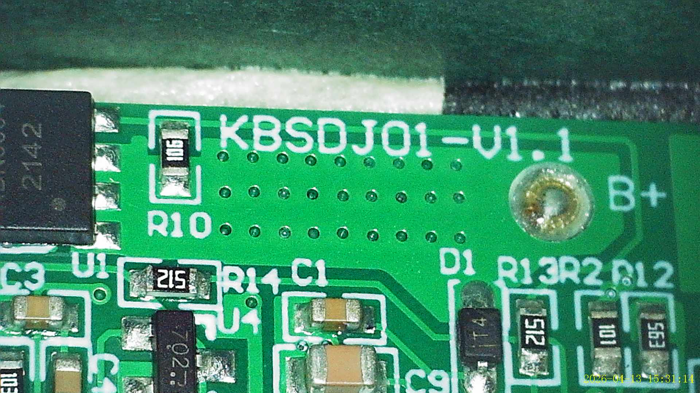 | Board **KBSDJ01-V1.1**, B+ cell tap. |
| 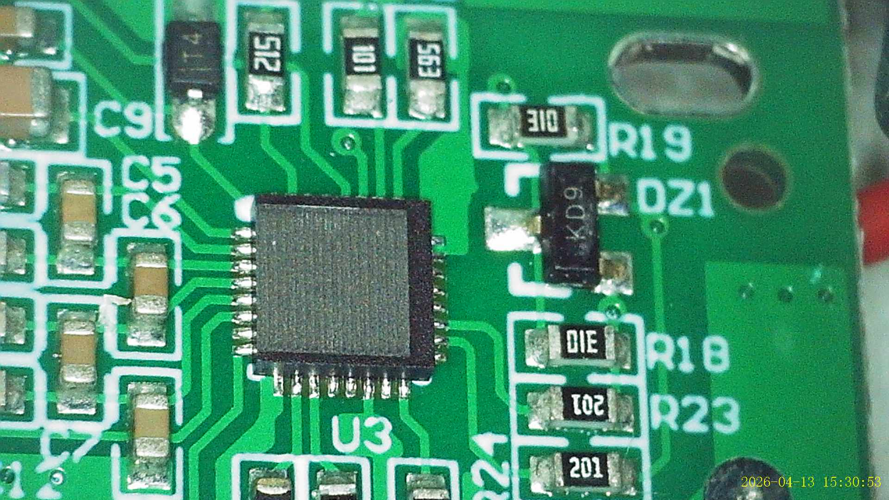 | **U3**, QFN-32: the bq40z50 gauge/protection IC. |
| 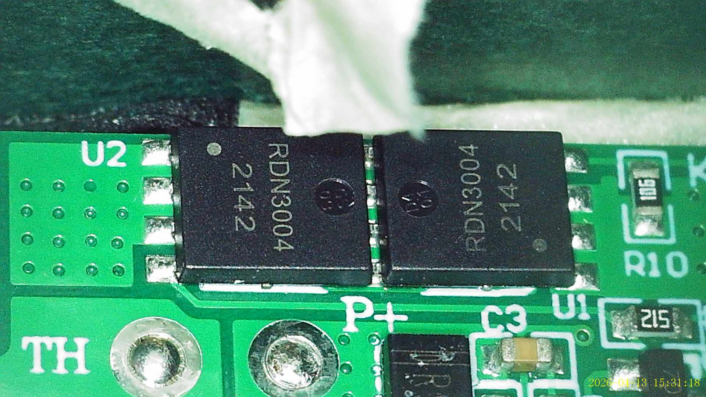 | **U2**, 2 × RDN3004 (date code 2142): charge and discharge MOSFETs. TH and P+ pads. |
| 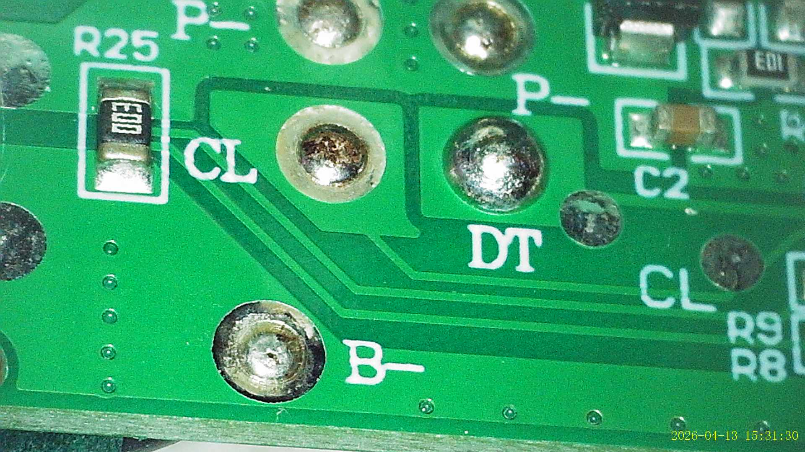 | **CL / DT** (SMBus) pads, P− and B−. |
| 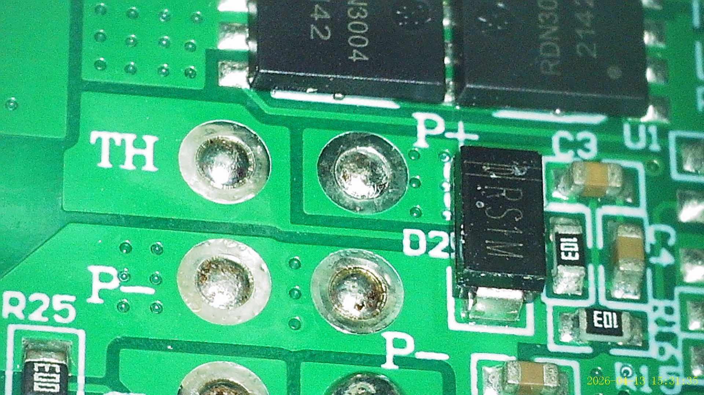 | **TH, P+, P−** output pads, D2 (RS1M). |
| 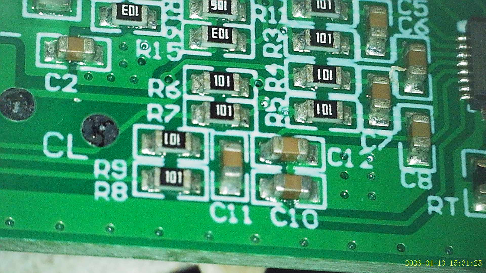 | Cell-voltage sense filter (R6–R9, C10–C12). |
| 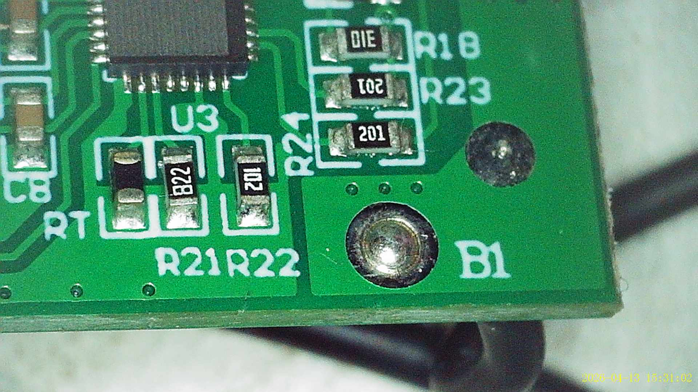 | B1 cell tap, RT, R21–R24. |
| 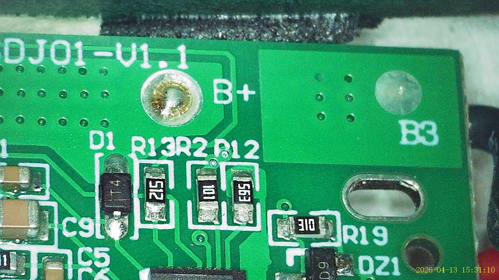 | B+ and B3 taps, D1, R12/R13. |
| 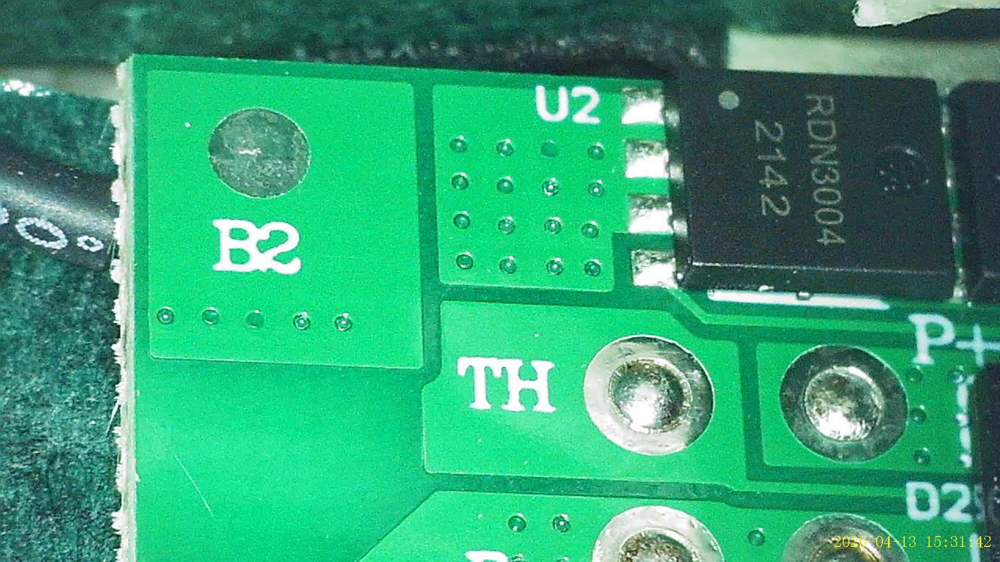 | B2 tap and TH pad. |
| 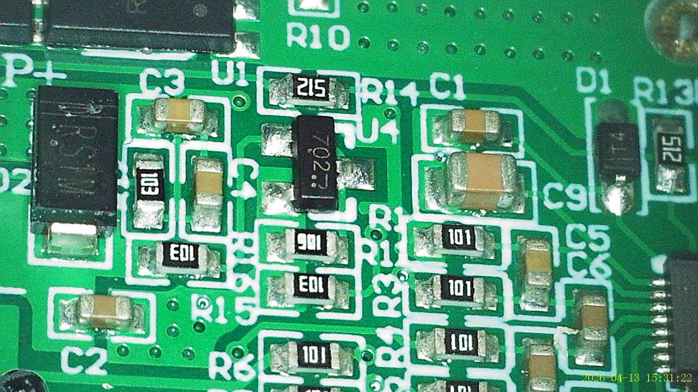 | U1/U4 area, D2. |
| 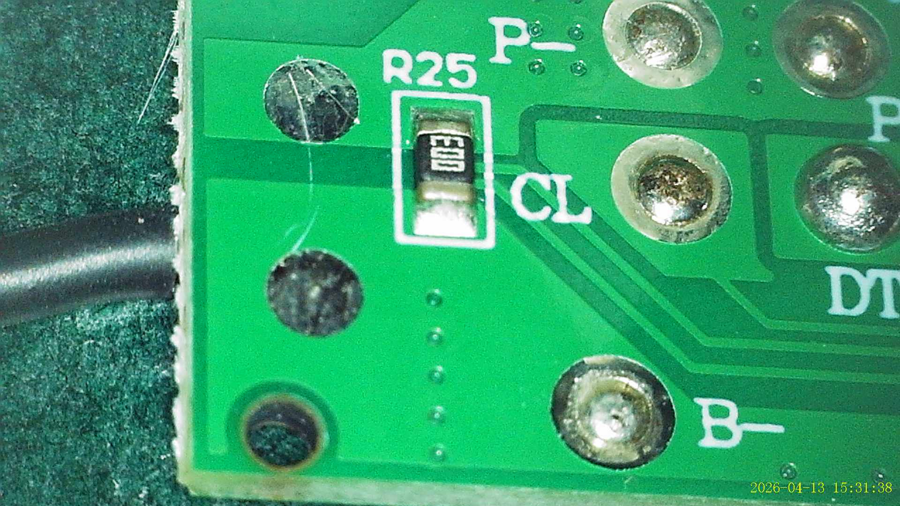 | R25, CL and B− corner. |
| 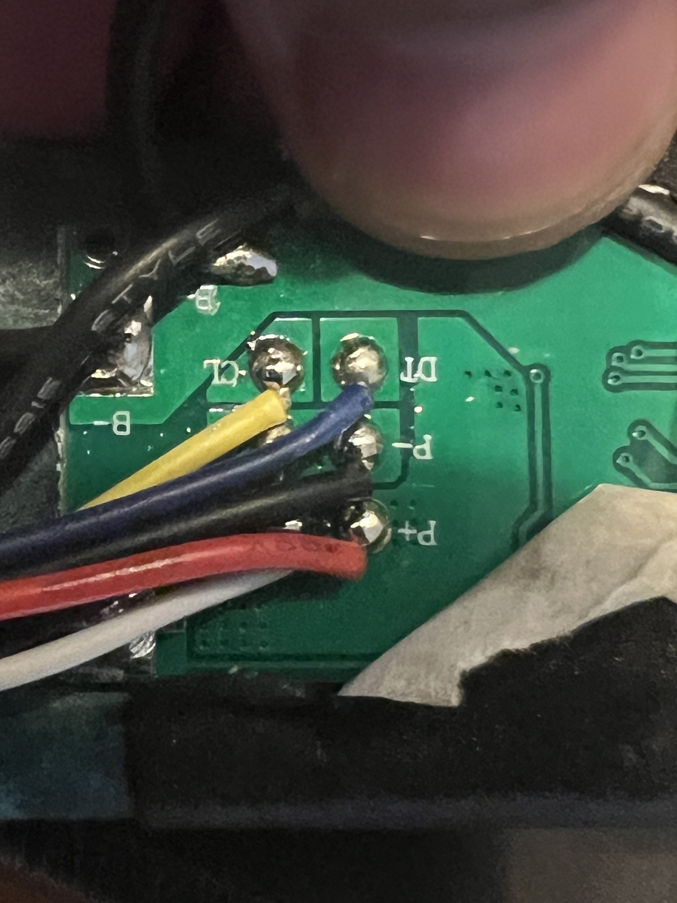 | Connector wiring: **yellow → CL, cyan → DT**, black → P−, red → P+. |

Visual inspection: nothing burnt; some uncleaned flux residue. The B2/B3 taps were suspected at first, but the SMBus data
later confirmed all four group voltages add up to the pack voltage, so all taps are connected.

### 4. Reading the gauge over SMBus with a Pico

Wiring (battery **out of the robot**, so the robot doesn't fight over the bus):

```
 Battery                      Raspberry Pi Pico
 cyan   (DT) ───────────────  GP4  (pin 6)  SDA
 yellow (CL) ───────────────  GP5  (pin 7)  SCL
 black  (P−) ───────────────  GND  (pin 3)
 red    (P+) ── NOT CONNECTED
 white  (TH) ── NOT CONNECTED
 (optional 4.7–10 kΩ pull-ups from GP4 and GP5 to 3V3(OUT), pin 36)
```

`tools/check_battery.sh read` (first read):

| Field | Value | Meaning |
|---|---|---|
| Manufacturer / device | ZH-D10 / bq40z50 | |
| Cell groups 1–4 | **1959 / 1797 / 2292 / 2100 mV** | Sum = 8148 mV = pack voltage, so all taps OK |
| Full-charge capacity / design | 4900 / 5200 mAh, 26 cycles | Capacity itself healthy |
| PFStatus | **0** | **No permanent failure**: recoverable |
| SafetyStatus | **CUV** | Cell under-voltage protection active |
| OperationStatus | CHG on, **DSG off** (XDSG) | Will accept charge, won't supply power |
| ChargingStatus | LV | Low-voltage (pre-charge) region |
| Requested charge | **88 mA**, 16.8 V | Gauge asks for a gentle pre-charge |
| Security mode | Full Access | Pack was never sealed at the factory |

### 5. The gauge's history log (lifetime data)

`tools/check_battery.sh lifetime`:

| Counter | Value |
|---|---|
| **CUV events** | **19**, last at cycle 26 |
| COV events | 1, at cycle 0 (assembly artifact) |
| Max charge / discharge current | 2197 mA / −3928 mA |
| Group min/max extremes | 0 V and 5.9–6.0 V on groups 3/4: physically impossible, so recorded during assembly |

**19 under-voltage cut-offs in 26 cycles** is the key finding. Instead of returning to the dock with charge to spare, the
robot repeatedly drove the pack until its protection cut out. The likely reason is that the robot trusts the gauge's
reported charge percentage, and this pack's percentage was unreliable (it reported `ConfidentOnFuel = 0`).

### 6. Deadlock: why nothing would charge it

- With cells this low, the gauge keeps the **discharge switch off**, so the connector reads **0 V**.
- The robot switched its charger on but **0 mA** flowed and it gave up. A "smart" 12 V car charger also refused to start:
  it saw 0 V and assumed no battery was connected.
- Charging *is* allowed (the CHG switch is on; current flows through the discharge MOSFET's body diode), but only a
  source that outputs voltage regardless of what it sees will start it.
- While sitting, the lowest group fell to about **1.78 V** and the gauge entered **shutdown**: it went silent on SMBus and
  opened both switches. Applying voltage to P+/P− woke it again.

(That the robot's charger needs to see battery voltage before it delivers current is an inference: it fits every
observation, but wasn't measured inside the robot.)

### 7. Unattended observation: groups 1 and 2

With nothing connected, groups 1 and 2 lost about 20 mV in ~30 minutes while groups 3/4 barely moved. This may hint at a
weak (self-discharging) cell in those pairs. **To be confirmed by a rest test** after the first full charge.

---

## The fix

### Phase 1: 12 V adapter through 68 Ω (10 × 680 Ω in parallel)

- ~40 mA at the start, tapering as the pack voltage rises (current = (V<sub>supply</sub> − ~0.5 V diode − V<sub>pack</sub>) / R).
- Pack **8.1 → 10.7 V**, group spread 515 → 77 mV, no heating.
- Self-limiting: a 12 V supply can't push the pack past about 11.6 V, which is safe to leave but just short of the 12.0 V
  needed to clear CUV.

### Phase 2: 19 V laptop adapter through ~150 Ω (10 resistors in parallel)

- ~59 → 49 mA, temperature 22 → ~25 °C, spread 79 → 56 mV. Log: [charge-logs/precharge-19v-log.txt](charge-logs/precharge-19v-log.txt).
- **Not self-limiting**, so supervised: `tools/battery_watchdog.py` followed the log and raised spoken/sound alarms
  ([charge-logs/watchdog-log.txt](charge-logs/watchdog-log.txt)).
- **CUV cleared at t = 6423 s, the instant the lowest group crossed 3000 mV**:

```
6422s  pack 12088 mV  45 mA  cells [3017, 2999, 3056, 3016]  safety CUV   output off
6423s  pack 12089 mV  45 mA  cells [3018, 3000, 3056, 3016]  safety none  output ON
```

### Phase 3: back in the robot

```
    time  fuel%  charging  enabled  dock  V_batt   I_mA  temp_C  V_dock  fault
14:01:06      4       yes      yes   yes   12.84   2087      24   18.45     no
14:03:07      5       yes      yes   yes   13.30   2084      26   18.47     no
14:07:06      8       yes      yes   yes   13.83   2083      27   18.46     no
```

The robot now charges the pack at full current.

---

## Bonus: the original battery

| | Original Panasonic pack | Aftermarket ZH pack (after recovery) |
|---|---|---|
| Made | 2016-09-09 | 2024-02-23 |
| Design capacity | 2100 mAh (4S1P) | 5200 mAh (4S2P) |
| **Learned full-charge capacity** | **344 mAh (16 %)** | 4900 mAh (94 %) |
| Cycle count | 2016 | 26 |
| Cell group spread | 151 mV | ~56 mV |
| Charge level | 1 % at 3.55 V per cell (high internal resistance) | — |

The original pack isn't faulty, it's worn out: about 10 minutes of cleaning at best. Its gauge is not TI-compatible (only
standard Smart Battery data is meaningful). **Recycle it.**

---

## Root cause

1. The aftermarket pack's state-of-charge reporting was unreliable, so the robot repeatedly ran it into under-voltage
   cut-off away from the dock (**19 CUV events in 26 cycles**).
2. After one such deep discharge the pack sat in CUV with its output off. The robot's charger (and smart chargers) won't
   start into a 0 V terminal, so the pack could not recover on its own.
3. Three months off the dock drained the cells further (≈1.8–2.1 V), until the gauge shut down completely.

The robot was never at fault, and there was no firmware lockout of non-original batteries.

## Prevention

- **Keep the robot on the dock** between cleans; never store it switched off for weeks.
- After recovery, let the pack complete a few full charge/discharge cycles so the gauge can relearn.
- If the robot still dies away from the dock, the pack's fuel gauge can't be trusted: replace it with a better pack.

## Still to do

- [ ] Rest test: 12–24 h after a full charge, compare group voltages (a group losing tens of mV more than the others = bad cell pair).
- [ ] First-clean runtime check.
- [ ] Watch temperatures during the first few full charges.

---

## Repository layout

```
README.md                  this report
docs/REPAIR_GUIDE.md       step-by-step repair procedure
images/                    board and wiring photos (all metadata stripped)
pico/                      MicroPython scripts that run on the Pico (all read-only)
  bq40z50_ping.py          once-a-second status line (voltages, current, temperatures, protection)
  bq40z50_read.py          full status dump, decoded flags
  bq40z50_monitor.py       10-second charge log with warnings
  bq40z50_lifetime.py      lifetime/history counters
tools/                     scripts that run on the computer
  check_battery.sh         runs the Pico scripts via mpremote (ping | read | monitor | lifetime)
  battery_watchdog.py      follows a ping log and sounds alarms (macOS)
  neato.py                 Neato robot USB console: commands and a --watch charging table
logs/                      raw logs from this repair
```

## Quick start

```bash
# Pico: flash MicroPython once (hold BOOTSEL, plug in, copy the RPI_PICO .uf2 from micropython.org)
tools/check_battery.sh                 # live status, Ctrl+C to stop
tools/check_battery.sh read            # full dump
tools/check_battery.sh > out.txt       # log to a file ...
python3 tools/battery_watchdog.py out.txt   # ... and let the watchdog alarm on it (macOS)

# Robot (USB under the dust bin):
.venv/bin/python tools/neato.py GetCharger GetErr
.venv/bin/python tools/neato.py --watch 60
```

The first run of `check_battery.sh` creates `.venv/` with `mpremote` and `pyserial`.

## References

- TI *bq40z50 Technical Reference Manual* (ti.com, bq40z50 product page): SBS commands, SafetyStatus/PFStatus/OperationStatus bits, lifetime data.
- *Smart Battery Data Specification* v1.1 (sbs-forum.org): standard registers 0x08–0x3F.
- MicroPython for Raspberry Pi Pico: <https://micropython.org/download/RPI_PICO/>
